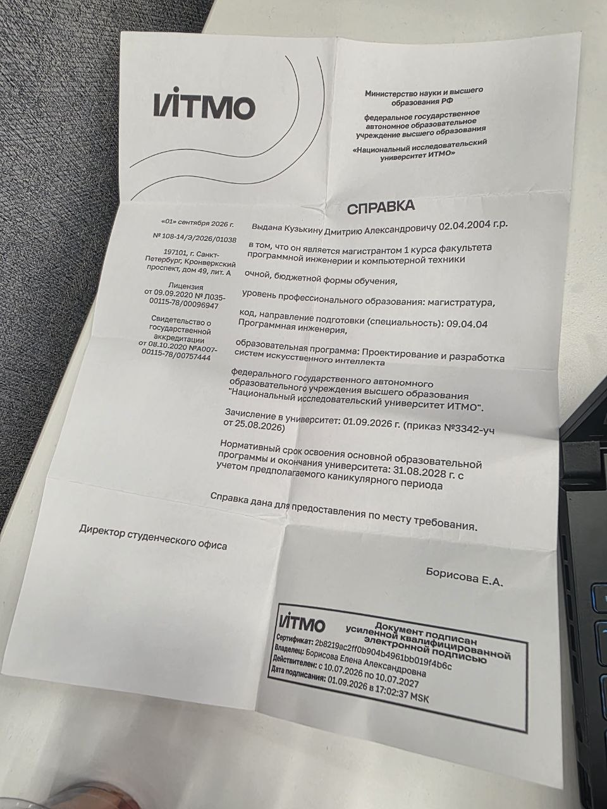
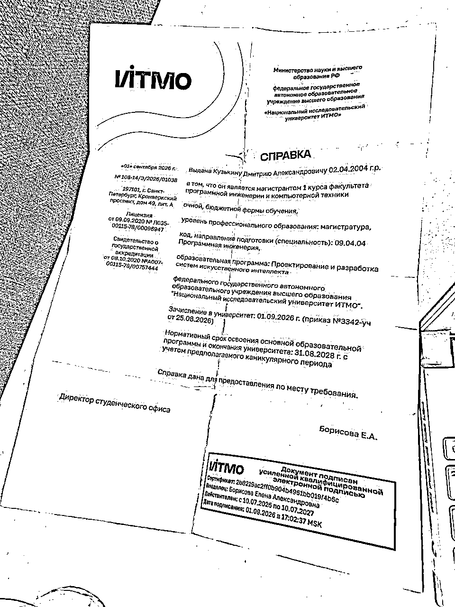
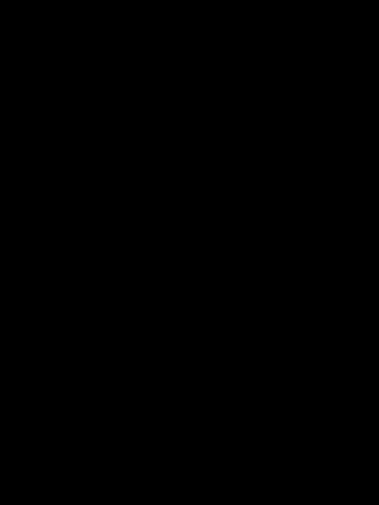

# ЛР1. Адаптивная бинаризация изображения

**Цель работы:** реализовать адаптивную бинаризацию двумя способами - вручную на Python и с помощью OpenCV - и сравнить скорость их работы.

## 1. Теория

Бинаризация преобразует изображение в чёрно-белое: каждый пиксель становится либо чёрным (0), либо белым (255).

При адаптивной бинаризации порог зависит от яркости соседних пикселей. В методе `mean` для каждого пикселя вычисляется средняя яркость в окне вокруг него, после чего из неё вычитается константа `C`.

В работе используются параметры: размер окна `11×11` и `C = 10`.

## 2. Реализация

Программа реализована двумя способами:

- `adaptive_native.py` - ручная реализация на Python. Для каждого пикселя перебираются пиксели его окна, вычисляется средняя яркость и определяется итоговый цвет.
- `adaptive_opencv.py` - реализация с помощью готовой функции `cv2.adaptiveThreshold` из библиотеки OpenCV.
- `compare.py` - сравнение результатов и времени работы.
- `common.py` - общие параметры и загрузка изображения.

## 3. Результаты

**Исходное изображение**

**Результат ручной реализации**

**Результат OpenCV**

**Карта различий**

Карта различий полностью чёрная, что означает отсутствие отличающихся пикселей между результатами двух реализаций.

### Сравнение скорости

чистый python = 4.8224 сек.
OpenCV = 0.0038 сек.

OpenCV выполнил обработку примерно в 1269 раз быстрее ручной реализации

Причина в том, что ручной вариант использует вложенные циклы Python и отдельно обрабатывает соседние пиксели для каждого пикселя изображения. OpenCV использует оптимизированную реализацию алгоритма, поэтому выполняет вычисления значительно быстрее

## 4. Вывод

В ходе работы была реализована адаптивная бинаризация методом mean двумя способами. Результаты ручной реализации совпали с результатами OpenCV. При этом библиотечная реализация оказалась значительно быстрее, поскольку использует оптимизированные вычисления

## 5. Источники

1. [OpenCV — Image Thresholding](https://docs.opencv.org/4.x/d7/d4d/tutorial_py_thresholding.html)
2. [OpenCV — adaptiveThreshold](https://docs.opencv.org/4.x/d7/d1b/group__imgproc__misc.html)
