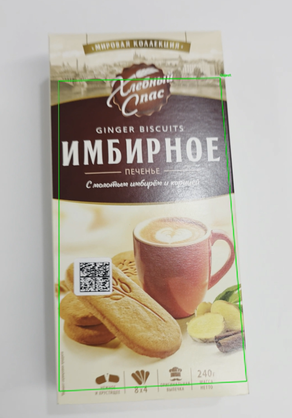

# ЛР2. Трекинг плоского объекта на видео по ключевым точкам

## 1. Теория

Для поиска объекта на кадре используются ключевые точки, которые можно найти повторно при сдвиге, повороте и изменении масштаба. Каждой точке сопоставляется дескриптор - вектор чисел, описывающий её окрестность. Я использовал детектор и дескриптор SIFT (128-мерный вектор), устойчивый к масштабу и повороту.

Точки эталона и кадра сопоставляются по близости дескрипторов. Ложные пары отсеиваются тестом Лоу: пара принимается, если расстояние до лучшего соседа заметно меньше, чем до второго. Так как объект плоский, его положение на кадре связано с эталоном проективным преобразованием - гомографией (матрица 3×3). Она оценивается алгоритмом RANSAC, который отбрасывает выбросы и оставляет согласованные пары (инлаеры). Применив гомографию к углам эталона, получаем четырёхугольник - рамку объекта на кадре.

## 2. Описание системы

Программа написана на python с opencv и numpy. Первый кадр видео целиком считается эталоном. Для него один раз считаются точки и дескрипторы SIFT. Затем для каждого кадра:

1. переводим кадр в оттенки серого и находим точки SIFT;
2. сопоставляем дескрипторы эталона и кадра (FLANN, k=2) и применяем ratio-тест (порог 0,75);
3. по хорошим парам оцениваем гомографию методом RANSAC (порог 5 px);
4. если инлаеров не меньше 12, проецируем углы эталона на кадр и проверяем, что полученный четырёхугольник выпуклый;
5. рисуем зелёную рамку с подписью, иначе кадр записывается без рамки.

Каждый кадр обрабатывается независимо, положение объекта с предыдущих кадров не используется. Размеченные кадры записываются в выходное видео. В конце выводятся число кадров, доля кадров с найденным объектом и скорость обработки.

## 3. Результаты

| Видео                       | Точек SIFT на эталоне | Кадров | Объект найден | FPS  |
|-----------------------------|-----------------------|--------|---|------|
| mona-lisa                   | 344                   | 558    | 219 (39,2%) | 17,5 |
| mona-lisa-blur              | 344                   | 558    | 197 (35,3%) | 17,8 |
| mona-lisa-blur-extra-credit | 343                   | 558    | 193 (34,6%) | 18,2 |
| мое видео                   | 55002                 | 431    | 234 (54.3%) | 0,7  |

Размытие немного снижает долю найденных кадров (с 39,2% до 35,3% и 34,6%), так как у размытого изображения меньше устойчивых точек. На тестовых видео скорость обработки около 17 кадров в секунду. На своём видео объект найден на 54.3% кадров, но скорость всего 0,7 кадра в секунду: видео снято на телефон в высоком разрешении, и на эталоне нашлось 55002 точка, поэтому сопоставление идёт заметно дольше.

## 4. Выводы

Реализован трекинг плоского объекта по ключевым точкам: SIFT, сопоставление дескрипторов с тестом Лоу и гомография с RANSAC. Когда объект найден, рамка строится по его границам с учётом поворота, масштаба и перспективы. На тестовых видео объект был найден на 35–39% кадров, размытие немного ухудшает результат, на своём видео - на 54.3%. Так как каждый кадр обрабатывается независимо, метод не использует информацию о предыдущем положении объекта; его можно улучшить, например, поиском только вокруг прошлой рамки или более мягкими порогами. На видео небольшого разрешения скорость близка к реальному времени, а на видео высокого разрешения она сильно падает (0,7 кадров в секунду), так как число ключевых точек растёт.
## 5. Использованные источники

1. Lowe D. Distinctive Image Features from Scale-Invariant Keypoints // IJCV, 2004.
2. Документация OpenCV: Feature Matching + Homography to find Objects - https://docs.opencv.org/4.x/d1/de0/tutorial_py_feature_homography.html
3. Fischler M., Bolles R. Random Sample Consensus // Communications of the ACM, 1981.
