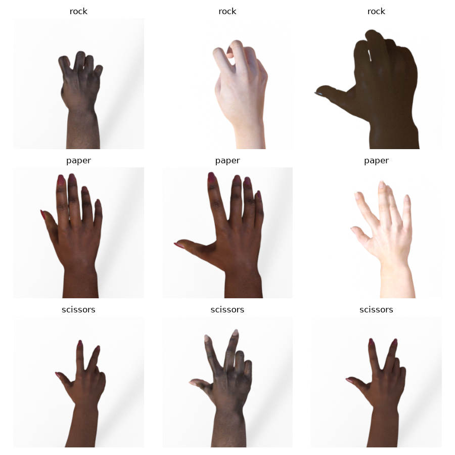
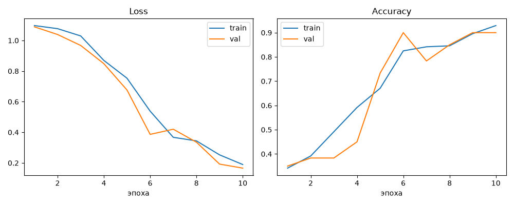
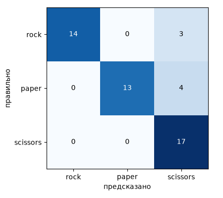
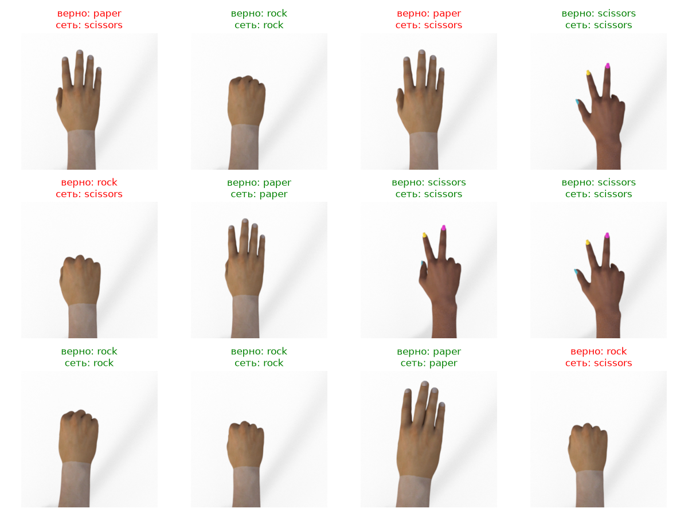

# ЛР3. Классификация изображений на основе сверточной нейронной сети

В работе сеть учится определять жест руки на фото: камень, ножницы или бумагу

## 1. Теория

Классификация изображений - это задача, в которой по картинке нужно выбрать один класс из заранее заданного набора. Сверточная нейронная сеть (CNN) решает её так: картинка проходит через несколько слоёв, каждый из которых вычисляет всё более сложные признаки, а в конце по этим признакам выбирается класс.

Основные слои, которые используются в работе:

- **Свёртка (Conv2d).** Небольшой фильтр (у нас 3×3) скользит по изображению и в каждой позиции считает взвешенную сумму пикселей. Так находятся простые признаки: границы, углы, а в более глубоких слоях - формы и части объекта. Веса фильтров не задаются вручную, а подбираются при обучении.
- **ReLU.** Функция `max(0, x)`, добавляет нелинейность. Без неё несколько слоёв подряд работали бы как один.
- **MaxPool.** Из каждого квадрата 2×2 оставляет максимум. Размер карты признаков уменьшается вдвое, а сеть становится менее чувствительной к небольшим сдвигам объекта.
- **Полносвязный слой (Linear).** Превращает найденные признаки в набор из трёх чисел, по одному на класс. Класс с наибольшим числом и есть ответ сети.

Для обучения нужна функция потерь. Использована кросс-энтропия (`CrossEntropyLoss`): числа на выходе сети превращаются в вероятности классов (softmax), а потеря равна минус логарифму вероятности правильного класса. Чем увереннее сеть в правильном ответе, тем потеря меньше. Веса обновляются методом обратного распространения ошибки, а шаг делает оптимизатор Adam.

Качество измеряется метрикой accuracy - долей правильных ответов. Классы в работе уравновешены (одинаковое число картинок), поэтому accuracy здесь подходит. Дополнительно строится матрица ошибок, которая показывает, какие классы сеть путает между собой.

Выборка делится на три части: train (на ней сеть учится), val (на ней следим за качеством во время обучения) и test (на ней оцениваем итог, сеть этих картинок не видела). Если на train качество хорошее, а на val заметно хуже, значит, модель переобучилась: запомнила обучающие примеры, а не научилась обобщать. Против переобучения используют dropout (случайное отключение части нейронов при обучении) и аугментацию (случайные повороты и отражения обучающих картинок).

## 2. О работе

**Данные.** Для train и val использован датасет Rock Paper Scissors: изображения рук в трёх жестах размером 300×300, сделанные в компьютерной графике на белом фоне. Из него случайно взято по 100 картинок каждого класса, то есть 300 в сумме. Они разделены на train (80 на класс, всего 240) и val (20 на класс, всего 60).

Test собран самостоятельно: 51 фото руки (по 17 на класс.

**Подготовка картинок.** Каждая картинка приводится к размеру 128×128 и переводится в тензор со значениями от 0 до 1. Для train дополнительно применяются случайное отражение по горизонтали и случайный поворот до 15°.

**Архитектура сети.** Три блока "свёртка - ReLU - MaxPool" и два полносвязных слоя:

| Слой                    | Размер на выходе |
|-------------------------|------------------|
| Вход                    | 3×128×128        |
| Conv 3×3, 16 + ReLU     | 16×128×128       |
| MaxPool 2×2             | 16×64×64         |
| Conv 3×3, 32 + ReLU     | 32×64×64         |
| MaxPool 2×2             | 32×32×32         |
| Conv 3×3, 64 + ReLU     | 64×32×32         |
| MaxPool 2×2             | 64×16×16         |
| Flatten + Dropout(0,5)  | 16384            |
| Linear + ReLU           | 128              |
| Linear                  | 3                |

Всего в сети 2121251 параметров

**Обучение.** Функция потерь - `CrossEntropyLoss`, оптимизатор - Adam со скоростью обучения 0,001, размер батча 32, 10 эпох. После каждой эпохи считаются loss и accuracy на train и на val. Метрика качества - accuracy, на test дополнительно строится матрица ошибок.

## 3. Результаты

**Примеры из обучающей выборки**

**Графики обучения**

| Выборка | Accuracy         |
|---------|------------------|
| train   | 0.908%           |
| val     | 0.950%           |
| test    | 0.882% (45 из 51) |

Матрица ошибок на test

Примеры предсказаний на test

Закономерности. На val качество высокое, так как val взят из того же датасета, что и train: те же фон, свет и стиль изображений. На собственных фото качество получилось ниже (0.392 против 0.882)
Реализована система классификации изображений на основе небольшой сверточной сети в PyTorch: три сверточных блока, два полносвязных слоя, кросс-энтропия и Adam. Сеть обучена на 240 изображениях и проверена на 60 изображениях val и 51 собственном тестовом фото. Accuracy составила 0.908 на train, 0.950 на val и 0.882 на test (45 из 51)
Признаков сильного переобучения на val нет: разница между train и val составляет 0.042, val loss не растёт к концу обучения. Более низкое качество на test объясняется тем, что собственные фото отличаются от обучающих

## 5. Использованные источники

1. Moroney L. Rock, Paper, Scissors Dataset - http://laurencemoroney.com/rock-paper-scissors-dataset
2. LeCun Y. et al. Gradient-Based Learning Applied to Document Recognition // Proceedings of the IEEE, 1998.
3. Kingma D., Ba J. Adam: A Method for Stochastic Optimization, 2014 - https://arxiv.org/abs/1412.6980
4. Srivastava N. et al. Dropout: A Simple Way to Prevent Neural Networks from Overfitting // JMLR, 2014.
5. PyTorch Tutorials: Training a Classifier - https://pytorch.org/tutorials/beginner/blitz/cifar10_tutorial.html
6. Stanford CS231n: Convolutional Neural Networks - https://cs231n.github.io/convolutional-networks/
